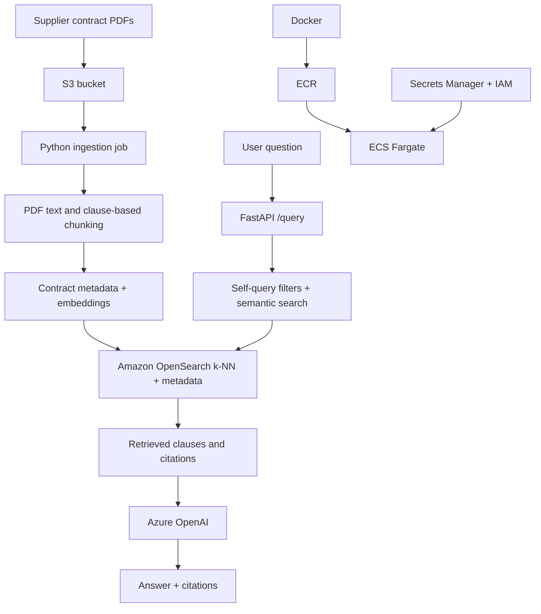

# Supplier Contract Intelligence Assistant

A demonstration RAG application for searching synthetic supplier contracts. It answers questions about renewal dates, termination notice periods, contract values and SLAs, with clause citations.

> All bundled contracts are fictional demonstration data. Do not upload real confidential or personal data.

## Architecture



## Quick start in VS Code (local demo)

Prerequisites: Docker Desktop, Python 3.11+, VS Code.

1. Extract this project folder and open it in VS Code.
2. Copy `.env.example` to `.env`.
3. In PowerShell:

```powershell
python -m venv .venv
.\.venv\Scripts\Activate.ps1
pip install -r requirements.txt
```

4. Generate 32 synthetic PDF contracts:

```powershell
python scripts/generate_contracts.py
```

5. Start local OpenSearch:

```powershell
docker compose up -d opensearch
```

Wait until `http://localhost:9200` responds. If Docker Desktop reports insufficient memory, increase its memory allocation (OpenSearch needs several GB in practice).

6. In a second VS Code terminal, ingest the PDFs:

```powershell
python scripts/ingest.py
```

The first embedding run downloads the Sentence Transformers model and may take a few minutes.

7. Start FastAPI:

```powershell
uvicorn app.main:app --reload
```

8. Open:
- Swagger: http://localhost:8000/docs
- Health: http://localhost:8000/health
- Streamlit (optional, separate terminal): `streamlit run app/ui.py`

For Streamlit, set `API_URL=http://localhost:8000` in `.env` or leave the default.

## Demo questions

- What is the notice period to terminate the CleanCo facilities contract?
- Which IT contracts auto-renew before 31 March 2027?
- Which facilities contracts expire in Q1 2027?
- What SLA penalty applies when service availability is below target?
- What is the contract value for TechPro?
- What is CleanCo's bank account number? (should not be answerable)

## Azure OpenAI

Set these values in `.env` to use Azure OpenAI for answer generation:

```env
AZURE_OPENAI_ENDPOINT=https://YOUR-RESOURCE.openai.azure.com/
AZURE_OPENAI_API_KEY=YOUR_KEY
AZURE_OPENAI_API_VERSION=2024-10-21
AZURE_OPENAI_CHAT_DEPLOYMENT=YOUR_CHAT_DEPLOYMENT_NAME
```

`AZURE_OPENAI_CHAT_DEPLOYMENT` is the deployment name, not necessarily the base model name. Never commit `.env`.

Without Azure credentials, the app uses a transparent local extractive fallback so the retrieval and citation demo still runs. Clearly disclose this if presenting before Azure is configured.

## Chunking and metadata

- PDF text is split on clause headings.
- Each SLA clause, including its table, remains one chunk.
- Supplier, category, start/end dates, contract value, auto-renewal flag and notice days are extracted from the contract header and attached to every chunk.
- Source filename, clause title, clause type and contract ID are also stored.

## Retrieval

Self-query parses category, supplier, auto-renewal status and common date expressions into OpenSearch filters. Semantic retrieval uses normalized Sentence Transformer embeddings and the OpenSearch k-NN index.

Cross-contract list questions with metadata filters use a structured filter query over matching chunks, not a small top-k vector search. The application deduplicates suppliers/contracts in its local list answer.

The natural-language parser is intentionally lightweight for this demo. Extend it with a validated LLM-based query parser if you need broader date, supplier and Boolean expression coverage.

## API

`GET /health`

`POST /query`

Request:

```json
{"question":"What is the notice period to terminate the CleanCo facilities contract?"}
```

Response contains `answer`, `citations`, `scores`, `filters_applied` and `retrieved_chunks`.

## Evaluation

A 30-question starter set is included at `data/evaluation.json`, including five unanswerable questions and cross-contract questions.

Run:

```powershell
python scripts/evaluate.py
```

The script reports:
- MRR
- Exact-match answer check
- List recall
- p95 latency

The evaluation is a starter harness. Review expected supplier labels against the generated synthetic contract dates before treating the result as final. Run before and after a documented change and record the actual measurements here. Do not invent results.

## Docker local run

Generate contracts first and copy `.env.example` to `.env`:

```powershell
python scripts/generate_contracts.py
docker compose up -d opensearch
docker compose build
docker compose run --rm api python scripts/ingest.py
docker compose up -d api ui
```

The API is at http://localhost:8000/docs and Streamlit at http://localhost:8501.
The first ingestion downloads the embedding model and can take several minutes.

To stop local services:

```powershell
docker compose down
```

To remove local OpenSearch data too:

```powershell
docker compose down -v
```

## AWS deployment

See `aws/README_AWS.md`, `aws/upload_to_s3.sh` and `aws/deploy_ecr_ecs.sh`.

Cloud flow: S3 → ingestion job → Amazon OpenSearch → FastAPI container → ECR → ECS Fargate. Use IAM task roles for AWS access and Secrets Manager for Azure/OpenSearch secrets. Run ingestion as a one-off job/task after the index is reachable.

## Future enhancements (README only; not implemented)

- Renewal-alert agent that emails contract owners before renewal and notice deadlines.
- Multi-agent negotiation preparation: clause risk analysis, supplier comparison and negotiation brief generation.

These agent ideas are future work only. This project currently implements RAG, not autonomous agents.
